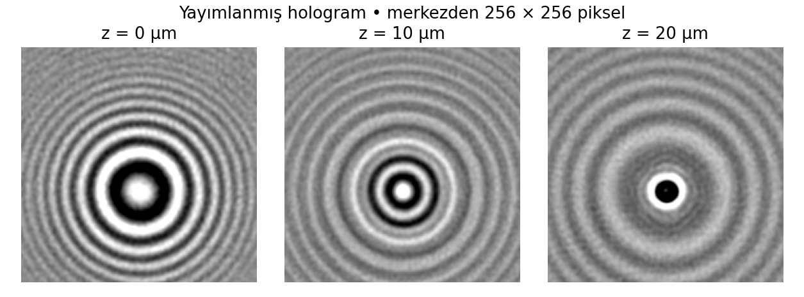

# Kamera ve optik ölçüm için beş ürün

İlk freelance teklif için tek kameralı saha kalibrasyonunu seçiyoruz. Bir entegratörün açık ihtiyacı ile aynı gün yeniden üretilen bir perspektif ölçümü bu teklifi destekliyor. Windows hologram yazılımı ana geliştirme ürünüdür. Diğer üç ürünün kabulü laboratuvar veya saha verisine bağlıdır.

| **Ürün** | **İlk teslim** | **Dayanağın gücü** |
| --- | --- | --- |
| U01 Tek kameralı saha kalibrasyonu | Profil ve hata raporu | Alıcı ilanı ve ölçüm |
| U02 Windows için hologram inceleme yazılımı | TIFF ve oturum kaydı | İlan kaydı ve açık veri |
| U03 Optik çözünürlük ve tekrar kurulum testi | Tekrar kurulum raporu | Yayımlanmış yöntem |
| U04 Kıyı suyunda parçacık ölçüm raporu | Eşlenik numune raporu | Yöntem ve ticari örnek |
| U05 Hava örneklerinde biriken parçacık sayacı | İşaretli birikim sayımı | Yayımlanmış saha örneği |

### Hangi sonucu gösterebiliriz

OpenCV’nin yedi görünümünde perspektif dönüşümü için ayrılan 217 noktada RMS hata 0,5811 px oldu. Altıncı görünüm tek başına 1,1395 px RMS verdi. Saha teklifinde genel ortalamanın yanında poz bazında hata da sunulmalıdır.

HoloPy verisinde her iki odak ölçütü 0 µm’de, tarama aralığının sınırında en büyük değeri verdi. Karşılaştırma ekranı için veri mevcut. Doğru fiziksel odağı gösterecek bağımsız bir referans hâlâ gerekiyor.

Aynı hologramın üç sayısal derinlikteki genliği. Üç görüntüde de aynı gri ton ölçeği kullanıldı.

**Dayanak:** [K01 Beş saha ürünü kartı](https://drive.google.com/file/d/17QdzCfpvYlGIjtKmFJMCt3jcbROXce5Q/view) — · — [K03 Gerçek veri deney paketi](https://drive.google.com/file/d/1swb3LcnBP64Owhf0y-6dOORokWarYEX-/view) — · — [K04 Hologram ve perspektif deney bulguları](https://docs.google.com/document/d/1ZoRw3Z9PAUq-whYVxs_wyvASm_wHuSuyIcBaqBKVuEs/edit)

## Yazılım ve kalibrasyon

### U01   Tek kameralı saha kalibrasyonu

camera-calibration-dewarping    /    İlk freelance teklif

Entegratörün her mekânda yeniden kuracağı tek kamerada, lens bozulmasını düzeltmek ve masa düzlemindeki konumu bulmak.

**İstenen girdiler:** Farklı pozlardan kalibrasyon hedefi görüntüleri, çözünürlük, hedef ölçüsü ve sahadan düzlem kontrol noktaları.

**Teslim:** Kamera profili, görüntü düzeltme betiği, masa dönüşümü ve kullanılmayan noktalarda hata raporu.

**Kapsam sınırı:** Sabit kamera modu ve çözünürlük için profil geçerlidir. Fiziksel uzunluk veya top takibi iddiası ayrıca sınanır.

**Dayanak:** [K03 Gerçek veri deney paketi](https://drive.google.com/file/d/1swb3LcnBP64Owhf0y-6dOORokWarYEX-/view) — · — [K06 Bilardo masası için kamera ilanı](https://www.upwork.com/freelance-jobs/apply/Computer-Vision-Specialist-Camera-Calibration-Image-Dewarping_~022109702111919657022/)

### U02   Windows için hologram inceleme yazılımı

lensless-holography-workbench    /    Ana geliştirme ürünü

Optik prototip ekibinin bir numunenin hangi ayrıntısının hangi sayısal derinlikte göründüğünü tekrar inceleyebilmesi.

**İstenen girdiler:** Numune ve boş referans karesi, piksel aralığı, dalga boyu, ortam ve kaynak–numune–sensör geometrisi.

**Teslim:** Düzlemleri karşılaştıran Windows arayüzü, seçili yoğunluk görüntüsü (TIFF) ve ayarlarıyla oturum kaydı (JSON).

**Kapsam sınırı:** İlk sürüm dosyadan çalışır. Pi RAW edinimi ikinci adımdır. Nokta kaynak ve düzlem dalga için uygun işleme modeli ayrı seçilir.

**Dayanak:** [K02 Pi ve Windows ilanının arşiv kaydı](https://docs.google.com/document/d/1jKmwONt0AX9C7JoqMFHQuLQ97qA4-eHfH8TH5uOmGw8/edit) — · — [K03 Gerçek veri deney paketi](https://drive.google.com/file/d/1swb3LcnBP64Owhf0y-6dOORokWarYEX-/view) — · — [K07 UNAL DLHM deneyleri](https://unal-optodigital.github.io/DLHM/)

### İlk teknik karar

Kalibrasyonda lens profili ile her sahaya özgü düzlem dönüşümünü ayrı sürümle. Holografide ilk kabulü yayımlanmış bir hologram ve boş referans üzerinde yap. Donanım entegrasyonunda kamera modelini ve gerçek optik mesafeleri ayrıca kaydet.

## Optik düzenek ve çevre ölçümü

### U03   Optik çözünürlük ve tekrar kurulum testi

optical-remount-verification    /    Laboratuvar kabul hizmeti

Prototipi teslim alan laboratuvarın, operatör tutucuyu söküp taktığında aynı ayrıntıyı benzer kontrastla ölçüp ölçemediğini görmesi.

**Girdi ve teslim:** Aynı USAF 1951 hedefinin iki kurulumdaki kareleri, hedef kimliği, yönü, fiziksel ölçek, aydınlatma ve odak kayıtları. Grup ve eleman bazında yatay/dikey çizgi profili, kontrast ve iki kurulumun ölçek ve odak farkları.

Yayımlanmış bir cihazın çözünürlüğü bu düzeneğin performansını belirlemez. Fiziksel sökme ve takma için cihaz ve operatör gerekir.

### U04   Kıyı suyunda parçacık ölçüm raporu

coastal-particle-validation    /    Eşlenik numune bekleyen pilot

Kıyı izleme laboratuvarının holografik ölçümün hangi boyut aralığında sayımı veya çapı saptırdığını belirlemesi.

**Girdi ve teslim:** Aynı numuneden holografik ve referans mikroskop ölçümü, iki ayrı hacim (mL), ortak boyut aralıkları ve görüntü konumu. Boyut sınıfına göre parçacık/mL, referansa göre çap sapması ve merkez–kenar karşılaştırması.

Antalya Körfezi aday pilot bölgedir. Eşlenik yerel veri ve sipariş kaydı henüz bulunmuyor.

### U05   Hava örneklerinde biriken parçacık sayacı

air-deposition-counter    /    Etiketli örnek bekleyen pilot

Örnekleme ekibinin aynı toplama yüzeyinde iki çekim arasında yeni biriken parçacıkları sayması.

**Girdi ve teslim:** Önce ve sonra kareleri, boş kontrol çifti, oturum zamanları, etiketler ve konsantrasyon için bağımsız ölçülmüş hava hacmi. Yeni birikimleri işaretleyen görüntü, olay tablosu, hatalı ve kaçırılan sayımlar, hacim varsa parçacık/L.

Sayım kütlesel PM2,5 sonucu vermez. Referans sayımın zaman aralığı ve hava hacmi eşleştirilir.

**Dayanak:** [K05 Optik düzenek ve çevresel saha analizi](https://docs.google.com/document/d/1k4f5wBAss5AMm9mKeYVLAkR_K8yZmavUiDIT0lPDUBE/edit) — · — [K11 Amann ve ark. optik çözünürlük çalışması](https://doi.org/10.1038/s41598-019-47689-1) — · — [K12 Walcutt ve ark. deniz parçacıkları](https://doi.org/10.1002/lom3.10379) — · — [K13 UCLA c-Air saha çalışması](https://innovate.ee.ucla.edu/wp-content/uploads/2010/03/2017-airquality.pdf)

Difüzör ve ölçülmüş nokta yayılım fonksiyonu (PSF) gerektiren karşılaştırma, bu beş ürünün kapsamı dışındaki araştırma adayıdır.
